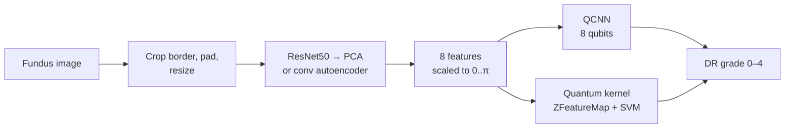

# Quantum Machine Learning for Diabetic Retinopathy Grading

Two quantum classifiers grade diabetic retinopathy (DR) severity, from 0 (no DR) to 4 (proliferative DR), on retinal fundus images from the [Indian Diabetic Retinopathy Image Dataset (IDRiD)](https://ieee-dataport.org/open-access/indian-diabetic-retinopathy-image-dataset-idrid). Both are benchmarked against classical models that receive exactly the same inputs.

- **QCNN:** a trainable quantum convolutional neural network built with Qiskit. It supports angle or amplitude encoding, data re-uploading, and a squared-error or softmax/cross-entropy readout.
- **Quantum kernel SVM:** a fidelity kernel from a Qiskit feature map, used by an SVM (`QSVC`).

A classical feature extractor first reduces each image to 8 numbers, one per qubit. It is either a convolutional autoencoder or ImageNet ResNet50 followed by PCA.



## Results

### Test set

These results are on the official IDRiD test split (103 images), with ResNet50 features, averaged over 5 seeds (0–4). Every model below the first row sees the same 8 features, apart from the last row. The hyperparameters were chosen by cross-validation on the training set (next section) before the test set was used.

| Model | Balanced accuracy | Quadratic kappa | Accuracy |
|---|---|---|---|
| Majority class | 0.200 | 0.000 | 0.311 |
| QCNN, original design (squared loss, 300 iterations) | 0.265 ± 0.058 | 0.358 ± 0.041 | 0.245 ± 0.026 |
| **QCNN, improved** (2× re-uploading, cross-entropy, 1000 iterations) | **0.336 ± 0.061** | 0.355 ± 0.052 | 0.317 ± 0.040 |
| **Quantum kernel SVM** (ZFeatureMap, bandwidth 0.25, C = 10) | 0.334 | **0.455** | 0.330 |
| Logistic regression | 0.343 ± 0.033 | 0.476 ± 0.022 | 0.334 ± 0.018 |
| MLP (16 hidden units) | 0.271 ± 0.023 | 0.474 ± 0.028 | 0.258 ± 0.030 |
| RBF-SVM | 0.367 | 0.454 | 0.369 |
| Logistic regression on all 2048 ResNet50 features | 0.383 ± 0.015 | 0.571 ± 0.004 | 0.503 ± 0.013 |

Both SVMs are deterministic given the features, so they have no spread across seeds.

With the convolutional autoencoder features, every model stays at chance level: QCNN 0.204 balanced accuracy, logistic regression 0.216, MLP 0.207, RBF-SVM 0.222.

### Model selection (3-fold cross-validation on the training set only)

| QCNN variant | Balanced accuracy | Quadratic kappa |
|---|---|---|
| Original: angle encoding, squared loss, 300 iterations | 0.279 ± 0.056 | 0.194 ± 0.122 |
| + softmax/cross-entropy readout | 0.303 ± 0.072 | 0.356 ± 0.055 |
| + 1000 iterations | 0.315 ± 0.043 | 0.302 ± 0.064 |
| Amplitude encoding (256 PCA features), cross-entropy, 1000 iterations | 0.277 ± 0.030 | 0.211 ± 0.133 |
| **2× data re-uploading, cross-entropy, 1000 iterations** | **0.326 ± 0.068** | **0.502 ± 0.105** |

The quantum kernel was searched over feature map ∈ {Z, ZZ}, bandwidth ∈ {0.1, 0.25, 0.5, 1}, and C ∈ {0.1, 1, 10}. The best setting was ZFeatureMap with bandwidth 0.25 and C = 10, at 0.476 ± 0.032 balanced accuracy and 0.722 kappa. The classical RBF-SVM was searched over a matching grid (γ ∈ {0.03, 0.1, 0.3, 1}, C ∈ {0.1, 1, 10}); its best setting was γ = 0.3 and C = 1, at 0.472 ± 0.060 balanced accuracy and 0.716 kappa. For reference, logistic regression on the same 8 features scored 0.424 and 0.674.

### What this shows

- **Better circuit design helps the QCNN.** Re-uploading the features and switching to a softmax/cross-entropy readout raised test balanced accuracy from 0.265 to 0.336. Cross-validation predicted the same direction before the test set was used.
- **The quantum kernel is the strongest quantum model.** It matches the classical RBF-SVM on kappa (0.455 vs 0.454) and is close to it on balanced accuracy.
- **No quantum advantage.** Neither quantum model beats the classical models on the same 8 features, and every 8-feature model trails logistic regression on all 2048 features. The 8-number bottleneck, not the classifier, sets the ceiling.
- **The QCNN is unstable.** Across seeds, the improved QCNN ranges from 0.23 to 0.40 balanced accuracy. Even tiny floating-point differences change where COBYLA ends up.
- **The training-set gains did not carry over.** The variants fit the training set better (up to 0.58 balanced accuracy) without improving validation scores, so overfitting is the limit, not training time.
- **Bandwidth matters for quantum kernels.** At full-range angles, ZZFeatureMap states of different images are close to orthogonal, the kernel approaches the identity, and the SVM is at chance level. Scaling the inputs down fixes this.
- **Accuracy alone is misleading.** Predicting grade 2 for every image scores 31% on the test set, so balanced accuracy and quadratic weighted kappa (the usual DR-grading metric) are reported.

These runs used Python 3.10, Qiskit 1.4.6, qiskit-machine-learning 0.8.4 and TensorFlow 2.21 (CPU) on a 2-core Linux machine.

## Models

### QCNN

| Stage | Qubits | Trainable angles |
|---|---|---|
| `ZFeatureMap` (angle encoding) or amplitude encoding | 0–7 | – |
| Optional re-uploading: a convolution layer, then the features again (per extra upload) | 0–7 | 24 each |
| Convolution `c1`: two-qubit blocks on neighbouring pairs | 0–7 | 24 |
| Pooling `p1`: 0→3, 1→4, 2→5, after which qubits 0–2 are dropped | 0–5 | 9 |
| Convolution `c2` | 3–7 | 12 |
| Readout: ⟨Z⟩ on qubits 3–7, one per DR grade (optionally softmax with a trainable scale) | 3–7 | (1) |

The model is trained with COBYLA. The predicted grade is the readout with the largest value.

### Quantum kernel SVM

The kernel is k(x, y) = |⟨φ(bx)|φ(by)⟩|², where φ is a `ZFeatureMap` or `ZZFeatureMap` on 8 qubits and b is the bandwidth. It is computed exactly with `FidelityStatevectorKernel` and used by `QSVC` with balanced class weights.

### Fast exact simulation

`qiskit-machine-learning`'s `EstimatorQNN` with Qiskit's exact reference `Estimator` needs about 20 seconds per COBYLA iteration on 680 training images. `qnn_dr.qcnn.StatevectorQNN` computes the same values in about 0.08 seconds:

- Everything that depends only on the inputs (the encoded states, and the single-qubit encoding unitaries for re-uploading) is computed once and cached.
- In each iteration, every trainable block becomes one 256×256 unitary, built with Qiskit's `Operator` and applied to all images in a single matrix product.

Tests check that it matches `EstimatorQNN` to within 1e-10 for angle encoding, re-uploading and amplitude encoding. To use the original path instead, pass `--simulator estimator`.

## Repository layout

```
qnn_dr/
  data.py        IDRiD loading, fundus cropping, class balancing
  features.py    conv autoencoder, ResNet50 features, PCA, scaling to [0, π]
  qcnn.py        QCNN variants, fast StatevectorQNN, classifier
  qkernel.py     quantum kernel SVM
  evaluate.py    metrics, classical baselines, plots
train.py         train on the training set, evaluate on the test set
cv.py            k-fold cross-validation on the training set only
tests/           unit and end-to-end tests on a small synthetic dataset
```

## Setup

Python 3.10–3.12:

```bash
python -m venv .venv && source .venv/bin/activate
pip install -r requirements.txt
```

## Data

IDRiD is not redistributed here. Download it from [IEEE DataPort](https://ieee-dataport.org/open-access/indian-diabetic-retinopathy-image-dataset-idrid) and use the **B. Disease Grading** part (413 training and 103 test images). Arrange it like this:

```
data/IDRiD/
  Excel/Training_Labels.csv     ← "2. Groundtruths/a. IDRiD_Disease Grading_Training Labels.csv"
  Excel/Testing_Labels.csv      ← "2. Groundtruths/b. IDRiD_Disease Grading_Testing Labels.csv"
  Training/IDRiD_001.jpg ...    ← "1. Original Images/a. Training Set"
  Testing/IDRiD_001.jpg ...     ← "1. Original Images/b. Testing Set"
```

## Run

```bash
# improved QCNN
python train.py --data-dir data/IDRiD --features pretrained --reuploads 2 --loss cross_entropy \
    --maxiter 1000 --cache-dir data/cache --out results/qcnn
# quantum kernel SVM
python train.py --data-dir data/IDRiD --features pretrained --model qsvc --cache-dir data/cache --out results/qsvc
# cross-validate a variant on the training set only
python cv.py --data-dir data/IDRiD --features pretrained --reuploads 2 --loss cross_entropy \
    --maxiter 1000 --cache-dir data/cache --seed 0 --out results/cv/L2_ce
```

| Flag | Default | Meaning |
|---|---|---|
| `--features` | `autoencoder` | `autoencoder` (trained on IDRiD) or `pretrained` (ImageNet ResNet50 + PCA) |
| `--model` | `qcnn` | `qcnn` or `qsvc` (quantum kernel SVM) |
| `--encoding` | `angle` | QCNN: `angle` (8 features) or `amplitude` (256 features) |
| `--reuploads` | 1 | QCNN: how many times the angle-encoded features enter the circuit |
| `--loss` | `squared_error` | QCNN: `squared_error` or `cross_entropy` (softmax readout) |
| `--maxiter` | 300 | QCNN: COBYLA iterations |
| `--simulator` | `statevector` | QCNN: `statevector` (fast, exact) or `estimator` (`EstimatorQNN`, slow) |
| `--kernel-map`, `--bandwidth`, `--svm-c` | `z`, 0.25, 10 | QSVC: feature map, input scaling, SVM C |
| `--cache-dir` | none | Reuse loaded images and ResNet50 features between runs |
| `--seed` | 42 | Seed for NumPy, TensorFlow and Qiskit |

Each run writes `metrics.json`, a confusion matrix and the circuit diagram to `--out`. QCNN runs also write the training loss curve.

## Tests

```bash
pytest -q
```

The 27 tests build a tiny synthetic IDRiD-style folder and run every stage end to end. They cover both feature extractors, every QCNN variant, the quantum kernel, cross-validation, and the match between the fast simulator and `EstimatorQNN`.

## Design notes

- **No test-set leakage.** Model choices come from cross-validation on the training set. PCA, scaling and the autoencoder are fitted on training rows only.
- **One feature per qubit.** For angle encoding, features are scaled to [0, π] using the training set, so the rotation angles use their full range.
- **Readout only on surviving qubits.** After pooling, qubits 0–2 are no longer used. The five readouts sit on qubits 3–7.
- **Class imbalance.** Grade 1 has only 20 training images. The QCNN and the logistic regression and MLP baselines train on oversampled data, and the SVMs use balanced class weights.
- **Cropping.** IDRiD images are 4288×2848 with wide black margins. They are cropped to the fundus, ignoring stray bright pixels at the edge, then padded to a square so the retina keeps its round shape.

## Limitations

- IDRiD has only 413 training images (20 in grade 1), and the 103-image test set makes every metric noisy. Most models score lower on the test set than in cross-validation; for example, the quantum kernel drops from 0.476 to 0.334 balanced accuracy, and logistic regression from 0.424 to 0.343.
- Everything runs on a noiseless simulator, not on quantum hardware.
- At 28×28 pixels (autoencoder path), the small lesions that separate the milder grades are mostly lost.

## Credits

The QCNN building blocks follow the [Qiskit Machine Learning QCNN tutorial](https://qiskit-community.github.io/qiskit-machine-learning/tutorials/11_quantum_convolutional_neural_networks.html). The quantum-kernel bandwidth idea follows [Shaydulin & Wild, "Importance of kernel bandwidth in quantum machine learning" (2022)](https://arxiv.org/abs/2111.05451).
